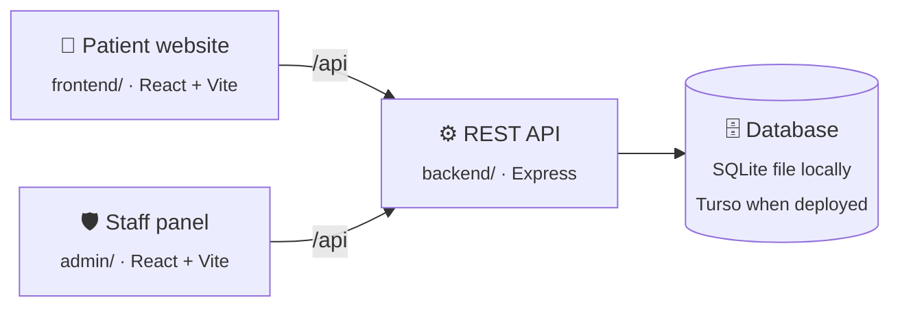

<div align="center">


# MedBook

**Book a doctor in under a minute.**
A full-stack doctor appointment system with a patient website, a staff panel for admins and doctors, and a REST API.


[Features](#-features) · [How it fits together](#-how-it-fits-together) · [Run locally](#-run-locally) · [Deploy for free](#-deploy-for-free) · [API](#-api-reference) · [Troubleshooting](#-troubleshooting)

</div>

---

## ✨ Features

<table>
<tr>
<td width="33%" valign="top">

### 🧑 Patients
- Browse doctors by speciality
- Pick a day and a 30-minute slot for the next 7 days
- Register, log in and edit a profile with a photo
- See, cancel and pay for appointments
- Demo payment with bKash, Nagad or card

</td>
<td width="33%" valign="top">

### 🩺 Doctors
- Dashboard with earnings, patients and latest bookings
- Mark appointments completed or cancel them
- Update fees, address and availability

</td>
<td width="33%" valign="top">

### 🛡️ Admin
- Dashboard with totals for doctors, patients and appointments
- Add doctors and switch their availability
- View and cancel every appointment

</td>
</tr>
</table>

> [!NOTE]
> Payments are a **demo only**. No money moves and no card or wallet details are sent to the server. The app only records that an appointment was marked as paid, with a `DEMO-…` reference.

---

## 🧭 How it fits together



| Folder | What it is | Local URL (`npm run dev`) | Deployed address |
|---|---|---|---|
| [`frontend/`](frontend) | Patient website | http://localhost:50000 | `https://<your-app>.onrender.com/` |
| [`admin/`](admin) | Staff panel (admin and doctor logins) | http://localhost:10000 | `https://<your-app>.onrender.com/admin/` |
| [`backend/`](backend) | REST API | http://localhost:4000 | `https://<your-app>.onrender.com/api/…` |
| — | Database | `backend/data/medbook.db` | Turso |

**One link for everything.** When deployed, the API also serves both built websites, so the whole app lives at a single address: patients use the main link, and staff add `/admin` (or click **Staff login** in the site footer).

The backend talks to the database through [`@libsql/client`](https://github.com/tursodatabase/libsql-client-ts). With no `TURSO_DATABASE_URL` set it uses a plain SQLite file. With one set it uses a hosted Turso database. The SQL is the same either way, and the tables are created automatically on startup.

Uploaded profile photos are stored in the database (`files` table) rather than on disk, so they survive restarts on free hosting.

---

## 🚀 Run locally

**You need:** [Node.js 22 or newer](https://nodejs.org).

**1. Install everything** (from the project folder):

```bash
npm run setup
```

**2. Create the settings files.** Copy each example file and edit the backend one:

```bash
cp backend/.env.example backend/.env
```

```bash
cp frontend/.env.example frontend/.env
```

```bash
cp admin/.env.example admin/.env
```

In `backend/.env`, set your own `ADMIN_PASSWORD` and a long random `JWT_SECRET`. This command prints one:

```bash
node -e "console.log(require('crypto').randomBytes(48).toString('hex'))"
```

**3. (Optional) Add sample doctors** so the site isn't empty. Put `SEED_DOCTOR_PASSWORD=<at least 8 characters>` in `backend/.env`, then:

```bash
npm run seed --prefix backend
```

**4. Start all three apps:**

```bash
npm run dev
```

Then open the **patient website** at http://localhost:50000 and the **staff panel** at http://localhost:10000.

Log in to the staff panel as **Admin** with `ADMIN_EMAIL` / `ADMIN_PASSWORD`, or as **Doctor** with a doctor's email and password.

<details>
<summary><b>Useful scripts</b></summary>

| Command | What it does |
|---|---|
| `npm run setup` | Installs the root, backend, frontend and admin packages |
| `npm run dev` | Starts the API, patient website and staff panel together |
| `npm run build` | Builds both websites into their `dist/` folders |
| `npm run seed --prefix backend` | Adds 6 sample doctors (skips ones that already exist) |
| `npm run smoke --prefix backend` | End-to-end check against a running API: books, pays, completes and cancels, then cleans up after itself |

</details>

<details>
<summary><b>Look inside the local database</b></summary>

Open `backend/data/medbook.db` with the free [DB Browser for SQLite](https://sqlitebrowser.org/). The tables are `users`, `doctors`, `appointments` and `files`.

</details>

---

## 🌍 Deploy for free

The whole app goes online as **one link**, using two free services. You'll need to create the accounts and click through their dashboards yourself. Each step says exactly what to fill in.

| Piece | Service | Why this one |
|---|---|---|
| 🗄️ Database | [Turso](https://turso.tech) | Hosted SQLite. Keeps your data permanently. |
| ⚙️ API + both websites | [Render](https://render.com) | One free web service. Set up from [`render.yaml`](render.yaml). |

> [!IMPORTANT]
> **Push this project to GitHub first.** Render deploys straight from your GitHub repository and redeploys automatically every time you push to `main`.

### Step 1 · Create the database on Turso

1. Sign up at [turso.tech](https://turso.tech) and open the dashboard.
2. Create a **database** (for example `medbook`). Pick the location closest to you.
3. Open the database and copy its **URL**. It starts with `libsql://`.
4. Create a **token** for the database (read & write) and copy it.

Keep both values for step 2. The tables are created automatically the first time the app starts.

<details>
<summary>Want to bring your local data along?</summary>

With the [Turso CLI](https://docs.turso.tech/cli/introduction) you can create the database from your local file instead:

```bash
turso db create medbook --from-file backend/data/medbook.db
```

This copies **everything** in the file, including test patients and their password hashes. Only do it if that's what you want.

</details>

### Step 2 · Put the app on Render

1. Sign up at [render.com](https://render.com) and connect your GitHub account.
2. Click **New → Blueprint** and choose this repository. Render reads [`render.yaml`](render.yaml) and sets up a free web service called `medbook`. It installs everything, builds both websites and starts the API.
3. Render asks for these values:

   | Variable | Value |
   |---|---|
   | `ADMIN_EMAIL` | Email for the admin login |
   | `ADMIN_PASSWORD` | A strong password for the admin login |
   | `TURSO_DATABASE_URL` | The `libsql://…` URL from step 1 |
   | `TURSO_AUTH_TOKEN` | The token from step 1 |

   `JWT_SECRET` is generated for you.
4. Click **Apply** and wait for the first deploy to finish (a few minutes).
5. Open your link, e.g. `https://medbook.onrender.com`:
   - **Patients:** `https://medbook.onrender.com`
   - **Staff:** `https://medbook.onrender.com/admin`

> [!TIP]
> If the name `medbook` is taken, Render adds a few letters to the address. You can see your exact link at the top of the service page.

### Step 3 · Add sample doctors (optional)

Run the seed **from your computer**, pointed at Turso. Use the values from step 1 and a password the sample doctors will log in with.

**macOS / Linux / Git Bash**

```bash
TURSO_DATABASE_URL="libsql://…" TURSO_AUTH_TOKEN="…" SEED_DOCTOR_PASSWORD="…" npm run seed --prefix backend
```

**Windows PowerShell**

```powershell
$env:TURSO_DATABASE_URL="libsql://…"; $env:TURSO_AUTH_TOKEN="…"; $env:SEED_DOCTOR_PASSWORD="…"; npm run seed --prefix backend
```

Or skip this step and add doctors from the staff panel instead (**Admin → Add Doctor**).

### 🎉 Done

Share the link with anyone. Staff use the same link with `/admin` at the end.

> [!NOTE]
> **The first visit can be slow.** Render's free plan puts the app to sleep after about 15 minutes without visitors. The next visit wakes it up in roughly 30–60 seconds, and after that it's fast again. Free-plan limits change from time to time, so check each service's pricing page.

---

## ⚙️ Configuration

### Backend (`backend/.env` locally, Render → Environment when deployed)

| Variable | Required | Description |
|---|:---:|---|
| `JWT_SECRET` | ✅ | Long random string that signs login tokens |
| `ADMIN_EMAIL` | ✅ | Admin login email |
| `ADMIN_PASSWORD` | ✅ | Admin login password |
| `PORT` | | Port to listen on. Render sets it automatically. Default `4000` |
| `TURSO_DATABASE_URL` | | `libsql://…` URL. If empty, a local SQLite file is used |
| `TURSO_AUTH_TOKEN` | | Token for the Turso database |
| `DATABASE_FILE` | | Local SQLite file path. Default `data/medbook.db` |
| `CORS_ORIGINS` | | Only if other websites call the API: comma-separated list. Empty allows all |
| `SEED_DOCTOR_PASSWORD` | | Only used by `npm run seed` |

The API refuses to start if any of the ✅ variables are missing.

### Websites (`frontend/.env`, `admin/.env`)

| Variable | Description |
|---|---|
| `VITE_BACKEND_URL` | Where the API runs during `npm run dev`. Default `http://localhost:4000`. Not used by the deployed site, which always talks to the server it's served from |

---

## 📡 API reference

Logged-in requests send a token in a header: `atoken` (admin), `dtoken` (doctor) or `token` (patient). Every response is JSON with a `success` field.

<details>
<summary><b>Patients</b> · <code>/api/user</code></summary>

| Method | Path | Auth | Description |
|---|---|:---:|---|
| `POST` | `/register` | | Create an account → `token` |
| `POST` | `/login` | | Log in → `token` |
| `GET` | `/get-profile` | 🔑 | Current patient's profile |
| `POST` | `/update-profile` | 🔑 | Update profile (multipart; optional `image` up to 2 MB) |
| `POST` | `/book-appointment` | 🔑 | `{ docId, slotDate, slotTime }` |
| `GET` | `/appointments` | 🔑 | The patient's appointments |
| `POST` | `/cancel-appointment` | 🔑 | `{ appointmentId }` |
| `POST` | `/payment-demo` | 🔑 | `{ appointmentId, paymentMethod: "bkash" \| "nagad" \| "card" }` |

</details>

<details>
<summary><b>Doctors</b> · <code>/api/doctor</code></summary>

| Method | Path | Auth | Description |
|---|---|:---:|---|
| `GET` | `/list` | | Public list of doctors |
| `POST` | `/login` | | Log in → `token` |
| `GET` | `/appointments` | 🔑 | The doctor's appointments |
| `POST` | `/complete-appointment` | 🔑 | `{ appointmentId }` |
| `POST` | `/cancel-appointment` | 🔑 | `{ appointmentId }` |
| `GET` | `/dashboard` | 🔑 | Earnings, patient count, latest bookings |
| `GET` | `/profile` | 🔑 | The doctor's profile |
| `POST` | `/update-profile` | 🔑 | `{ fees, address, available }` |

</details>

<details>
<summary><b>Admin</b> · <code>/api/admin</code></summary>

| Method | Path | Auth | Description |
|---|---|:---:|---|
| `POST` | `/login` | | Log in → `token` |
| `POST` | `/add-doctor` | 🔑 | Create a doctor (`address` is a JSON string) |
| `POST` | `/all-doctors` | 🔑 | Every doctor |
| `POST` | `/change-availability` | 🔑 | `{ docId }`: toggle availability |
| `GET` | `/appointments` | 🔑 | Every appointment |
| `POST` | `/cancel-appointment` | 🔑 | `{ appointmentId }` |
| `GET` | `/dashboard` | 🔑 | Totals and latest bookings |

</details>

<details>
<summary><b>Other</b></summary>

| Method | Path | Description |
|---|---|---|
| `GET` | `/health` | `{"ok":true}` when the API and database are up |
| `GET` | `/uploads/:id` | A stored profile photo |
| `GET` | `/`, `/admin/` | The built patient website and staff panel (when `npm run build` has been run) |

</details>

---

## 🗂️ Project structure

```text
.
├── render.yaml              # Render Blueprint: one service for API + both websites
├── package.json             # setup / dev / build scripts for everything
├── backend/
│   ├── server.js            # Express app, uploads, health check, serves the built sites
│   ├── config/sqlite.js     # libSQL client (local file or Turso) + schema
│   ├── controllers/         # admin, doctor and patient logic
│   ├── middlewares/         # JWT checks for each role, image upload
│   ├── models/              # small model layer over SQL, file storage
│   ├── routes/              # /api/admin, /api/doctor, /api/user
│   └── scripts/             # seed.js, smokeTest.js
├── frontend/                # patient website  → served at /
│   └── src/{pages,components,context,assets}
└── admin/                   # staff panel      → served at /admin/
    └── src/{pages/Admin,pages/Doctor,components,context,assets}
```

---

## 🛠️ Troubleshooting

<details>
<summary><b>The page takes a long time to open, or shows "Something went wrong while fetching doctors data"</b></summary>

The app is probably waking up on Render's free plan. Wait up to a minute and refresh.

</details>

<details>
<summary><b>The staff panel link shows the patient website</b></summary>

Make sure the address ends in `/admin` (for example `https://medbook.onrender.com/admin`).

</details>

<details>
<summary><b>The Render deploy fails or the API exits right away</b></summary>

Open **Logs** on Render:
- `Missing required environment variables` means a required value is empty. Fill it in under **Environment**.
- `Unable to start the database` means `TURSO_DATABASE_URL` or `TURSO_AUTH_TOKEN` is wrong or expired. Create a new token in Turso.
- A failure during the **build** step usually means a package install or website build failed. The log line just above the error says which one.

</details>

<details>
<summary><b>Everyone got logged out</b></summary>

Login tokens are signed with `JWT_SECRET`. Changing it signs everyone out. Just log in again.

</details>

---

<div align="center">
<sub>MedBook is a demo project. Don't use it for real patient records without adding proper security, backups and privacy compliance.</sub>
</div>
